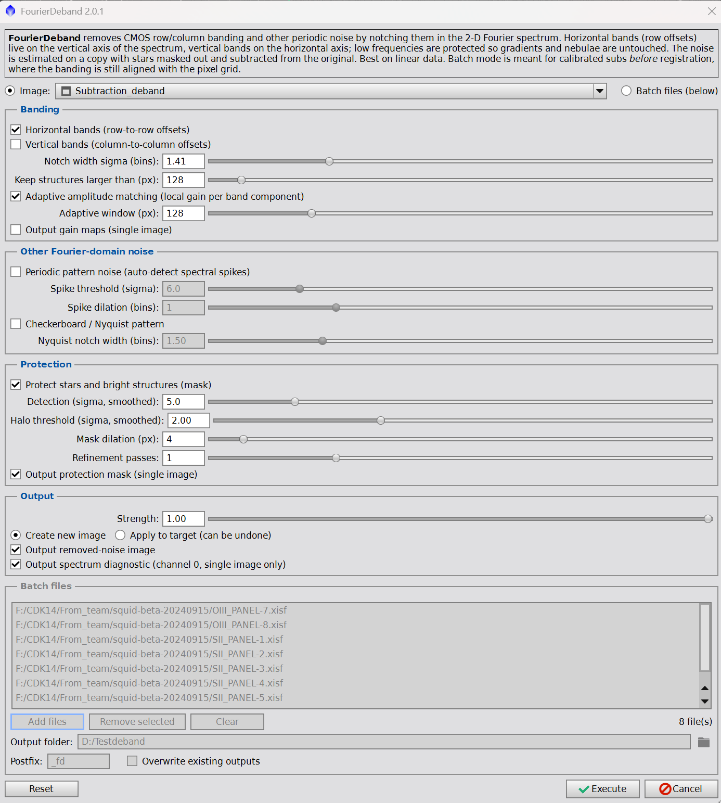

# Fourier Deband for PixInsight

Removes CMOS row/column banding (and optionally checkerboard and periodic interference
patterns) by estimating them in the 2-D Fourier spectrum and subtracting the estimate from
the original image. Stars, halos and saturated cores are protected so they do not leak into
the estimate; optional adaptive amplitude matching handles bands whose strength varies
across the sensor. Single images or batches of calibrated subs.

* `FourierDeband.js` – the script (version 1.4). Install: PixInsight › Script › Feature Scripts › Add
  (folder containing the file), then Script › Utilities › FourierDeband.
* `FourierDeband_how_it_works.docx` – user guide and technical description: quick start,
  recommended settings, the algorithm step by step with equations, validation, troubleshooting.

The numerical core between `// ==== CORE BEGIN` and `// ==== CORE END` is plain ECMAScript 5
without PixInsight objects; the dialog and file handling are tested against the
PixInsight classes.

Author: Black Rig (Erellaz). License: MIT
